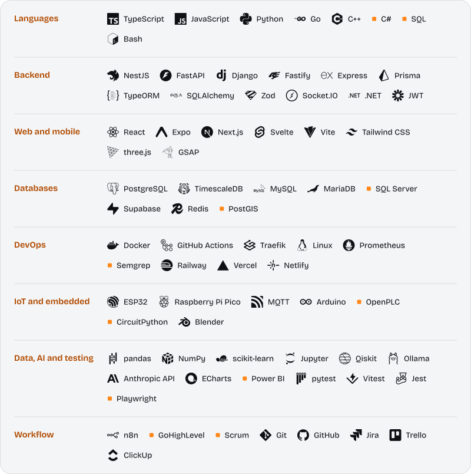

<picture>
  <source media="(prefers-color-scheme: dark)" srcset="assets/banner-dark.svg">
  
</picture>

[LinkedIn](https://www.linkedin.com/in/maximiliano-cocito) &nbsp;·&nbsp; [Email](mailto:maxcocito@gmail.com) &nbsp;·&nbsp; Resistencia, Chaco, Argentina

<!-- Portfolio link goes here once the domain is chosen. -->

## About

I build the plumbing between systems: n8n workflows and REST APIs that move data around, pipelines that clean it, and the apps and ESP32 hardware at the other end. I like projects where software meets the real world, like lockers, vehicle fleets and sustainability indicators.

- **Studying** Information Systems Engineering at UTN Resistencia, 5th year, with graduation expected in 2027.
- **Researching** as a Beca BIS fellow at UTN (CInApTIC), where I designed and built the MVP of SUSI, a sustainability indicators platform for universities.
- **Building** LockIT!, my final degree project: an open smart-locker network for last-mile delivery in Argentina. Team of 5, run with Scrum.
- **Competing** at the Huawei ICT Competition 2024/2025 (Computing track): 1st in the national and Latin American rounds, 2nd in the Global Final in Shenzhen, among 179 teams from 48 countries. Also 2nd at the Rally Latinoamericano de Innovación 2023.
- **Writing** two papers submitted to CoNaIISI 2026, on open smart lockers for Argentine last-mile delivery and on how Reddit conversation relates to the stock market.
- **Speaking** Spanish (native) and English (C1).

Leer en español

 

Soy estudiante de quinto año de Ingeniería en Sistemas de Información en la UTN FRRe (egreso estimado 2027) y becario de investigación. Me enfoco en automatización de procesos, integración de sistemas mediante APIs y pipelines de datos, y me gusta que el software toque el mundo real: lockers inteligentes, flotas de vehículos, indicadores de sostenibilidad. Fui 2.º en la final global de la Huawei ICT Competition 2024/2025, en Shenzhen.

## Projects

<table>
<tr>
<td valign="top" width="50%">

**LockIT!** · final degree project 
Open smart-locker network for last-mile delivery. NestJS API with 14 Prisma models and the shipment lifecycle as a state machine, a React Native app, and a hardware prototype (ESP32, QR reader, servo lock) over MQTT on TLS. 13 sprints, 75 user stories. 
NestJS · PostgreSQL · React Native · ESP32 · MQTT · private repository

</td>
<td valign="top" width="50%">

**[flota-ops](https://github.com/MaxDCoc/flota-ops)** 
Six n8n workflows for a workshop that serves company fleets, started with one command. A Python API cleans the supplier's price list into a staging table, rejected rows keep their reason, and every flow is idempotent. 29 tests and CI. 
n8n · FastAPI · pandas · PostgreSQL · Docker Compose · GitHub Actions

</td>
</tr>
<tr>
<td valign="top" width="50%">

**[SUSI](https://github.com/MaxDCoc/SUSI)** · research project 
Sustainability indicators platform for UTN. Django REST Framework backend with audit history and object-level permissions, a React and ECharts frontend, PostgreSQL on Supabase. 
Django · React · ECharts · Supabase · Docker

</td>
<td valign="top" width="50%">

**[VoltCare Analytics](https://github.com/MaxDCoc/VoltCare-Analytics)** 
Data engine over 50,000+ synthetic service tickets for a B2B electric-vehicle maintenance provider. MTTR, preventive vs corrective balance and RFM segments, served by a Go HTTP API that orchestrates the Python scripts, with Power BI dashboards. 
Python · pandas · Go · Docker · Power BI

</td>
</tr>
<tr>
<td valign="top" width="50%">

**[Climax](https://github.com/MaxDCoc/climax)** · [live demo](https://climax-phi.vercel.app) 
PWA for an independent refrigeration technician who used to manage about 5 clients a day from memory and WhatsApp. Clients, equipment and service history, plus a rule that schedules the next maintenance by service type. Six pytest suites in CI. 
FastAPI · SQLAlchemy · Alembic · React · TypeScript · Supabase

</td>
<td valign="top" width="50%">

**[ChePrecio](https://github.com/MaxDCoc/ChePrecio)** 
Price comparison app that reads photographed shelf labels with Anthropic's vision API and matches them against SEPA and Precios Claros data. NestJS API with JWT and versioned migrations, deployed from CI to Railway. 
NestJS · TypeORM · React Native (Expo) · Railway

</td>
</tr>
<tr>
<td valign="top" width="50%">

**[Dashboard La Fabiana](https://github.com/MaxDCoc/Dashboard-La-Fabiana)** · [live demo](https://dashboard-la-fabiana.vercel.app) 
A Power BI report for a care residence, migrated to an interactive web dashboard. The ETL reads the source Excel with only Python's standard library, and the indicators were checked against the original report. 
Python · JavaScript · Vite · ECharts · Vercel

</td>
<td valign="top" width="50%">

**CrowdWisdom** · with a teammate 
Reddit conversation versus the stock market: five containerized microservices around Postgres, about 70,000 mentions labeled with a local LLM, and a backtester. A +55% yearly result was thrown out after checking that the signal measured attention, not prediction. 
Python · FastAPI · TimescaleDB · Ollama · scikit-learn

</td>
</tr>
</table>

## Activity

  <picture>
    <source media="(prefers-color-scheme: dark)" srcset="assets/cards/stats-dark.svg">
    
  </picture>
  <picture>
    <source media="(prefers-color-scheme: dark)" srcset="assets/cards/languages-dark.svg">
    
  </picture>

  <picture>
    <source media="(prefers-color-scheme: dark)" srcset="assets/cards/recent-dark.svg">
    
  </picture>

## Stack

  <picture>
    <source media="(prefers-color-scheme: dark)" srcset="assets/stack-dark.svg">
    
  </picture>

## Contribution graph

  <picture>
    <source media="(prefers-color-scheme: dark)" srcset="https://raw.githubusercontent.com/MaxDCoc/MaxDCoc/output/snake-dark.svg">
    
  </picture>

The banner, stack panel and activity cards are SVGs generated by the scripts in [`scripts/`](scripts), with the text drawn as outlines so they look the same everywhere. The cards refresh every day and the snake twice a day, both with GitHub Actions.
