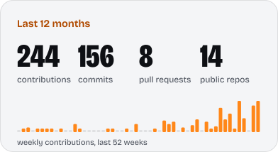
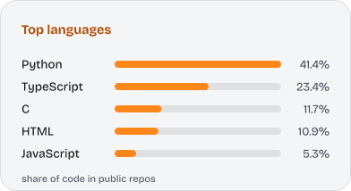
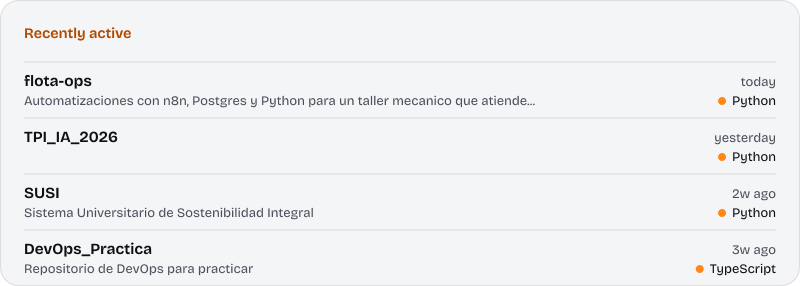

<picture>
  <source media="(prefers-color-scheme: dark)" srcset="assets/banner-dark.svg">
  
</picture>

[LinkedIn](https://www.linkedin.com/in/maximiliano-cocito) &nbsp;·&nbsp; [Email](mailto:maxcocito@gmail.com) &nbsp;·&nbsp; Resistencia, Chaco, Argentina

<!-- Portfolio link goes here once the domain is chosen. -->

## About

I build the whole system: the database, the API, the app and the firmware of the device it controls. I like projects where software meets something physical, like lockers, conveyor lines and sustainability indicators, and the ones that go deep into how things work, like a Redis-compatible server or a decision tree written from scratch.

- **Studying** Information Systems Engineering at UTN Resistencia, 5th year, with graduation expected in 2027.
- **Researching** as a Beca BIS fellow at UTN (CInApTIC), where I designed and built the MVP of SUSI, a sustainability indicators platform for universities.
- **Building** LockIT!, my final degree project: an open smart-locker network for last-mile delivery in Argentina. Team of 5, run with Scrum.
- **Competing** at the Huawei ICT Competition 2024/2025 (Computing track): 1st in the national and Latin American rounds, 2nd in the Global Final in Shenzhen, among 179 teams from 48 countries. Also 2nd at the Rally Latinoamericano de Innovación 2023.
- **Writing** two papers submitted to CoNaIISI 2026, on open smart lockers for Argentine last-mile delivery and on how Reddit conversation relates to the stock market.
- **Speaking** Spanish (native) and English (C1).

Leer en español

 

Soy desarrollador full stack, estudiante de quinto año de Ingeniería en Sistemas de Información en la UTN FRRe (egreso estimado 2027) y becario de investigación. Trabajo sobre todo el stack: diseño el modelo de datos, escribo la API, construyo la aplicación web o móvil que la consume y, cuando el sistema lo necesita, el firmware del dispositivo que se conecta. Me gustan los proyectos donde el software toca algo físico (lockers, cintas transportadoras, indicadores de sostenibilidad) y los que llegan hasta el fondo de cómo funcionan las cosas, como un servidor compatible con Redis o un árbol de decisión escrito desde cero. Fui 2.º en la final global de la Huawei ICT Competition 2024/2025, en Shenzhen.

## Projects

<table>
<tr>
<td valign="top" width="50%">

**LockIT!** · final degree project 
Open smart-locker network for last-mile delivery. NestJS API with 14 Prisma models and the shipment lifecycle as a state machine, a React Native app with three role-based experiences, and a hardware prototype (3D-printed locker, ESP32, QR reader, servo lock) over MQTT on TLS. 13 sprints, 75 user stories. 
NestJS · PostgreSQL · React Native · ESP32 · MQTT · private repository

</td>
<td valign="top" width="50%">

**CrowdWisdom** · with a teammate 
Reddit conversation versus the stock market: five containerized microservices around Postgres, about 70,000 mentions labeled with a local LLM, and a backtester. A +55% yearly result was thrown out after checking that the signal measured attention, not prediction. 
Python · FastAPI · TimescaleDB · Ollama · scikit-learn

</td>
</tr>
<tr>
<td valign="top" width="50%">

**[Climax](https://github.com/MaxDCoc/climax)** · [live demo](https://climax-phi.vercel.app) 
PWA for an independent refrigeration technician who used to manage about 5 clients a day from memory and WhatsApp. Clients, equipment and service history, plus a rule that schedules the next maintenance by service type. Six pytest suites in CI. 
FastAPI · SQLAlchemy · Alembic · React · TypeScript · Supabase

</td>
<td valign="top" width="50%">

**[ChePrecio](https://github.com/MaxDCoc/ChePrecio)** 
Price comparison app that reads photographed shelf labels with Anthropic's vision API and matches them against SEPA and Precios Claros data. NestJS API with JWT and versioned migrations, deployed from CI to Railway. 
NestJS · TypeORM · React Native (Expo) · Railway

</td>
</tr>
<tr>
<td valign="top" width="50%">

**[SUSI](https://github.com/MaxDCoc/SUSI)** · research project 
Sustainability indicators platform for UTN: practice, indicator, measurement, evidence, validation, dashboard, with the software's own footprint measured through the SCI metric. Django REST Framework backend with audit history and object-level permissions, React and ECharts frontend. 
Django · React · ECharts · Supabase · Docker

</td>
<td valign="top" width="50%">

**carpincho** 
A Redis-compatible in-memory database server written from scratch in Go: RESP2, strings, lists, hashes, sets, key expiry, pub/sub and an append-only file with crash recovery. A sharded keyspace about 11 times faster than a global lock, and 88 to 97% of Redis' throughput without pipelining. Native fuzz tests. 
Go · RESP2 · TCP · Docker · GitHub Actions

</td>
</tr>
<tr>
<td valign="top" width="50%">

**Faro** 
Uptime monitor with public status pages. A separate worker claims checks with `FOR UPDATE SKIP LOCKED`, an incident state machine avoids flapping, notifications go through a transactional outbox, and the status page updates live over Server-Sent Events. 168 tests against a real PostgreSQL. 
TypeScript · Fastify · PostgreSQL · React · Prometheus

</td>
<td valign="top" width="50%">

**[C4.5 from scratch](https://github.com/MaxDCoc/TPI_IA_2026)** 
A C4.5 decision tree written without any tree library (gain ratio, missing values, pessimistic pruning), compared with Random Forest on the UCI Heart Disease dataset. Nested cross-validation, an anywidget interface for notebooks, and pytest. 
Python · pandas · scikit-learn · pytest

</td>
</tr>
</table>

### More work

- **[Real-time auctions with DevOps](https://github.com/MaxDCoc/DevOps_Practica)**: NestJS and Socket.IO scaled to three API replicas behind Traefik with sticky sessions, Redis adapter, Semgrep and images published from GitHub Actions.
- **[Bottling line IoT](https://github.com/MaxDCoc/Lab-Automatizacion-Cinta-Tranportadora-Botellas)**: Raspberry Pi Pico 2W with CircuitPython, two control loops, jam detection and MQTT telemetry, built in a team for an automation course.
- **[VoltCare Analytics](https://github.com/MaxDCoc/VoltCare-Analytics)**: a data engine over 50,000+ synthetic service tickets, served by a Go HTTP API and Power BI dashboards.
- **[Dashboard La Fabiana](https://github.com/MaxDCoc/Dashboard-La-Fabiana)** · [live demo](https://dashboard-la-fabiana.vercel.app): a Power BI report for a care residence migrated to a web dashboard, with an ETL that uses only Python's standard library.
- **[flota-ops](https://github.com/MaxDCoc/flota-ops)**: six n8n workflows and a Python ETL for a workshop that serves company fleets, with idempotent flows, 29 tests and CI.
- **Sales funnel with GoHighLevel**: Next.js funnel, webhooks, 4 workflows and 150 tests for the Pareto Talent Bootcamp final project (private repository).
- **Personal portfolio**: bilingual React and TypeScript site with a 3D scene of the LockIT! locker modelled in Blender, Lighthouse 100 in accessibility, best practices and SEO.
- **Earlier work**: [Bienal del Chaco](https://github.com/MaxDCoc/TPI_DesarrolloSW_2024) (SvelteKit, real-time voting by QR), [web GIS viewer](https://github.com/MaxDCoc/gis_TPI) (React, OpenLayers, GeoServer, PostGIS), [car repair shop system](https://github.com/MaxDCoc/CRUD_TallerMecanico_2024) (C#, .NET 8, Blazor).
- **Coursework**: [lexer and parser in C](https://github.com/MaxDCoc/ParserLexer_2023), [relational database](https://github.com/MaxDCoc/TPI_Bases-de-Datos_2024), [project planning](https://github.com/MaxDCoc/TPI_Planificacion_2024), algorithms in [C](https://github.com/MaxDCoc/LabC_2022) and [Pascal](https://github.com/MaxDCoc/LabPascal_2022), and a [website for Codo a Codo](https://github.com/MaxDCoc/TPO_Codo-a-Codo_2021).

## Activity

  <picture>
    <source media="(prefers-color-scheme: dark)" srcset="assets/cards/stats-dark.svg">
    
  </picture>
  <picture>
    <source media="(prefers-color-scheme: dark)" srcset="assets/cards/languages-dark.svg">
    
  </picture>

  <picture>
    <source media="(prefers-color-scheme: dark)" srcset="assets/cards/recent-dark.svg">
    
  </picture>

## Stack

  <picture>
    <source media="(prefers-color-scheme: dark)" srcset="assets/stack-dark.svg">
    
  </picture>

## Contribution graph

  <picture>
    <source media="(prefers-color-scheme: dark)" srcset="assets/snake/snake-dark.svg">
    
  </picture>

The banner, stack panel and activity cards are SVGs generated by the scripts in [`scripts/`](scripts), with the text drawn as outlines so they look the same everywhere. The cards refresh every day and the snake twice a day, both with GitHub Actions.
